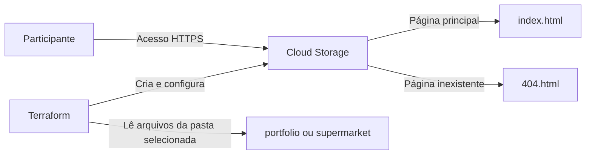

# Workshop: Portfólio no Google Cloud Storage com Terraform

Este projeto demonstra, ao vivo, como criar uma infraestrutura na Google Cloud Platform (GCP) usando Terraform e publicar um portfólio estático em um bucket do Cloud Storage.

Ao final do workshop, o participante terá um site hospedado no Google Cloud Storage e conhecerá os principais conceitos do fluxo de trabalho do Terraform.

## O que será criado

O Terraform cria os seguintes recursos:

- Um bucket no Cloud Storage para hospedar os arquivos estáticos.
- Objetos no bucket correspondentes aos arquivos da pasta selecionada por `project_folder` (por exemplo, `portfolio/index.html` e `portfolio/404.html`).
- Permissão pública de leitura para que o conteúdo possa ser acessado pela internet.
- Configuração do bucket como site estático, usando a página principal e a página de erro.

A infraestrutura está definida na pasta `infra`.

```text
lab-terraform-cloud-storage-portfolio/
├── infra/
│   ├── data.tf
│   ├── locals.tf
│   ├── main.tf
│   ├── output.tf
│   ├── providers.tf
│   ├── variables.tf
│   ├── inventories/dev/terraform.tfvars
│   ├── portfolio/
│   │   ├── index.html
│   │   └── 404.html
│   └── supermarket/
│       ├── index.html
│       └── 404.html
└── instalacao/
    ├── install-gcp-cli.sh
    ├── auth-gcp-cli.sh
    └── install-terraform.sh
```

## Arquitetura



O valor de `project_folder` seleciona a pasta local dentro de `infra` e também define o prefixo dos objetos no bucket. Por exemplo, com `project_folder = "portfolio"`, os arquivos de `infra/portfolio` são publicados em `portfolio/`. O Terraform também concede ao grupo `allUsers` o papel `roles/storage.objectViewer`.

## Pré-requisitos

Antes do workshop, instale:

- Git Bash no Windows.
- Google Cloud CLI.
- Terraform versão 1.5 ou superior.
- Uma conta Google com acesso a um projeto do GCP.
- Permissão para criar buckets e políticas IAM no projeto.
- Faturamento ativado no projeto.

Os scripts disponíveis em `instalacao` podem ajudar na preparação do ambiente:

```bash
./instalacao/install-gcp-cli.sh
./instalacao/install-terraform.sh
./instalacao/auth-gcp-cli.sh
```

Os scripts devem ser executados no Git Bash do Windows.

Para conferir as instalações:

```bash
gcloud --version
terraform version
```

## Configuração do projeto GCP

Autentique-se no Google Cloud:

```bash
gcloud auth login
gcloud auth application-default login
```

Selecione ou crie um projeto:

```bash
gcloud projects list
gcloud config set project SEU_PROJECT_ID
```

No arquivo `infra/inventories/dev/terraform.tfvars`, substitua o valor de exemplo de `project_id` pelo número do projeto GCP, conforme o tipo numérico declarado em `infra/variables.tf`:

```hcl
project_id = 123456789012
```

Nesse mesmo arquivo, substitua o valor de exemplo de `project_folder` pelo nome da pasta do site que deseja publicar. As pastas disponíveis neste repositório são `portfolio` e `supermarket`:

```hcl
project_folder = "portfolio"
```

Para publicar o outro site, altere o valor para `"supermarket"`. A pasta precisa existir dentro de `infra` e conter os arquivos do site.

O nome do bucket é definido pela variável `bucket_name` em `infra/variables.tf`. Como nomes de buckets são únicos globalmente, escolha um nome próprio caso o padrão já esteja em uso. O bucket usa exatamente o valor configurado; não é acrescentado automaticamente um sufixo de ambiente.

Exemplo de configuração completa para o ambiente `dev`:

```hcl
project_id     = 123456789012
project_folder = "portfolio"
```

## Execução passo a passo

Entre na pasta da infraestrutura:

```bash
cd infra
```

### 1. Inicializar o Terraform

```bash
terraform init
```

Esse comando baixa o provider Google, inicializa os módulos e prepara o diretório `.terraform`.

### 2. Validar a configuração

```bash
terraform fmt -check
terraform validate
```

Use `terraform fmt` para organizar os arquivos caso sejam feitas alterações.

### 3. Inspecionar o plano

```bash
terraform plan -var-file=inventories/dev/terraform.tfvars
```

O plano mostra os recursos que serão criados sem aplicar mudanças no projeto.

### 4. Criar a infraestrutura

```bash
terraform apply -var-file=inventories/dev/terraform.tfvars
```

Confirme digitando `yes` quando solicitado. Para aprovar automaticamente, use:

```bash
terraform apply -var-file=inventories/dev/terraform.tfvars -auto-approve
```

### 5. Consultar os resultados

```bash
terraform output
terraform output -raw website_url
```

As saídas `website_url` e `not_found_url` usam o valor de `project_folder`. Por exemplo, com `project_folder = "portfolio"`:

- Página principal: `https://storage.googleapis.com/NOME_DO_BUCKET/portfolio/index.html`
- Página 404: `https://storage.googleapis.com/NOME_DO_BUCKET/portfolio/404.html`

## Como o código funciona

### Provider

`infra/providers.tf` configura o provider oficial da Google e exige Terraform 1.5 ou superior:

```hcl
provider "google" {
  project = var.project_id
  region  = "us-central1"
}
```

### Variáveis

`infra/variables.tf` declara `bucket_name`, `project_id` e `project_folder`. O arquivo `infra/inventories/dev/terraform.tfvars` fornece o número do projeto e a pasta do site para o ambiente `dev`. `project_folder` tem como padrão `portfolio`, mas pode ser alterada para outra pasta existente.

As variáveis permitem trocar o projeto, o bucket ou a pasta publicada sem modificar os recursos Terraform.

### Arquivos locais

`infra/locals.tf` usa `fileset` para localizar todos os arquivos dentro da pasta escolhida por `project_folder`:

```hcl
locals {
  website_files = fileset("${path.module}/${var.project_folder}", "**")
}
```

No recurso `google_storage_bucket_object`, `for_each` cria um objeto no bucket para cada arquivo encontrado. A origem local e o prefixo no bucket usam o valor de `project_folder`: os arquivos de `infra/portfolio` são armazenados em `portfolio/`, enquanto os arquivos de `infra/supermarket` são armazenados em `supermarket/`.

### Bucket

`infra/main.tf` cria o bucket com:

- `uniform_bucket_level_access` para centralizar as permissões por IAM.
- `force_destroy = true` para facilitar a limpeza em laboratório.
- `public_access_prevention = inherited` conforme a configuração do projeto.
- `website` para definir a página principal e a página de erro.

### Permissão pública

O recurso `google_storage_bucket_iam_member` atribui `roles/storage.objectViewer` ao membro `allUsers`.

Isso permite que visitantes públicos baixem os objetos do bucket sem autenticação.

## Personalização do portfólio

Edite os arquivos na pasta do site que será publicado, por exemplo, `infra/portfolio` ou `infra/supermarket`:

- `index.html`: página principal.
- `404.html`: página exibida para caminhos inexistentes.

Depois execute:

```bash
terraform apply -var-file=inventories/dev/terraform.tfvars
```

Defina `project_folder` em `infra/inventories/dev/terraform.tfvars` para a pasta escolhida. Como o recurso utiliza `for_each`, novos arquivos adicionados a essa pasta também podem ser detectados e enviados ao bucket.

## Alteração segura da infraestrutura

O fluxo recomendado durante o workshop é:

```bash
terraform fmt
terraform validate
terraform plan -var-file=inventories/dev/terraform.tfvars
terraform apply -var-file=inventories/dev/terraform.tfvars
```

Sempre revise o `terraform plan` antes do `apply`. Ele identifica alterações, recursos a serem criados, atualizados ou destruídos.

## Estado do Terraform

Neste laboratório, o estado está armazenado localmente por meio de `terraform.tfstate`.

Em ambientes reais ou com várias pessoas trabalhando juntas, o estado deve ser armazenado em um backend remoto, como um bucket do Cloud Storage com controle de acesso e versionamento.

Não compartilhe arquivos de estado ou exponha-os em repositórios públicos, pois eles podem conter dados sensíveis.

## Limpeza dos recursos

Para remover todos os recursos criados pelo laboratório:

```bash
cd infra
terraform destroy -var-file=inventories/dev/terraform.tfvars
```

Confirme digitando `yes` ou use:

```bash
terraform destroy -var-file=inventories/dev/terraform.tfvars -auto-approve
```

Como o bucket possui `force_destroy = true`, os objetos são removidos antes da exclusão do bucket.

## Problemas comuns

### Nome do bucket já existe

O nome do bucket deve ser globalmente único no Google Cloud.

Altere `bucket_name` em `infra/variables.tf` ou defina outro valor em `infra/inventories/dev/terraform.tfvars` e execute o plano novamente:

```bash
terraform plan -var-file=inventories/dev/terraform.tfvars
```

### Tipo ou valor incorreto em `project_id`

Na configuração atual, `project_id` está declarado como `number` em `infra/variables.tf`. Informe o número do projeto sem aspas em `infra/inventories/dev/terraform.tfvars`. Para consultar o número, use `gcloud projects list`.

### Pasta do site não encontrada

Confirme que `project_folder` corresponde a uma pasta existente dentro de `infra` e que ela contém pelo menos os arquivos `index.html` e `404.html`. Por padrão, o valor é `portfolio`.

### Permissão negada

Verifique a conta ativa:

```bash
gcloud auth list
gcloud config get-value project
```

Confirme que sua conta possui permissões de Storage e IAM no projeto e que o faturamento está habilitado.

### Provider não encontrado

Execute:

```bash
terraform init -upgrade
```

### Estado local não atualizado

Compare o estado conhecido pelo Terraform com os recursos reais:

```bash
terraform plan -var-file=inventories/dev/terraform.tfvars
```

## Encerramento do workshop

Ao concluir, os participantes devem conseguir explicar:

- A função do provider Google.
- A diferença entre `terraform plan` e `terraform apply`.
- Como `bucket_name`, `project_id`, `project_folder` e arquivos `.tfvars` configuram o ambiente e selecionam o site.
- Como `resource`, `local`, `for_each` e `output` funcionam.
- Como o Terraform gera e utiliza o estado.
- Como arquivos locais são publicados no Cloud Storage.
- Como excluir os recursos criados com `terraform destroy`.
